# Práctica servidor web

## 1. Título

**Creación y personalización de dos servidores web con Nginx utilizando contenedores Docker y el editor nano**

## 2. Tiempo de duración

90 minutos.

## 3. Fundamentos

Un servidor web es un programa que permite mostrar páginas y otros contenidos a través de una red. Cuando una persona escribe una dirección en el navegador, el servidor recibe la solicitud y envía los archivos necesarios para que la página pueda visualizarse. Los servidores web se utilizan en páginas institucionales, tiendas virtuales, portales de información y muchos otros sitios de Internet. La comunicación entre el navegador (cliente) y el servidor se realiza mediante el protocolo HTTP, como se muestra en la Figura 3-1.

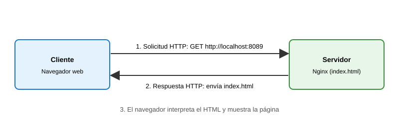

**Figura 3-1.** Comunicación entre el navegador y el servidor web mediante HTTP.

Nginx es un servidor web que permite entregar páginas HTML y otros archivos a los usuarios. Es conocido por su rendimiento y porque también puede utilizarse como intermediario entre diferentes aplicaciones. En esta práctica se utiliza Nginx para publicar dos páginas web sencillas y comprobar que ambas funcionan desde el navegador.

Docker es una herramienta que permite ejecutar aplicaciones dentro de contenedores. Un contenedor reúne lo necesario para ejecutar un programa en un entorno separado del resto del sistema. A diferencia de una máquina virtual, que necesita un sistema operativo completo para cada aplicación, los contenedores comparten el núcleo del sistema anfitrión, por lo que son más livianos y se inician más rápido (Figura 3-2). Esto facilita probar aplicaciones sin tener que realizar toda la instalación directamente en el computador, y permite ejecutar varios servicios al mismo tiempo, siempre que se configuren correctamente.

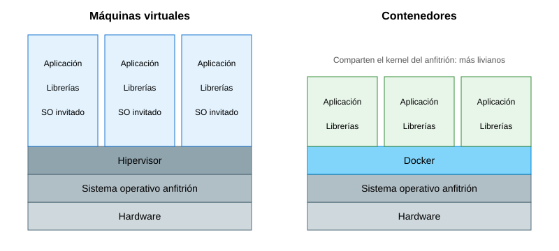

**Figura 3-2.** Diferencia entre máquinas virtuales y contenedores.

Una imagen Docker es la base que se utiliza para crear un contenedor. En este caso, se utiliza la imagen oficial de Nginx para crear dos contenedores independientes. Cada uno ejecuta su propio servidor web y tiene sus propios archivos. Aunque los dos utilizan Nginx, pueden mostrar páginas diferentes.

Para acceder a los servidores desde el computador, se configura la asignación de puertos. En esta práctica, el primer servidor utiliza el puerto `8089` del computador y el segundo utiliza el puerto `8090`. Ambos se conectan al puerto `80` dentro de sus respectivos contenedores, que es el puerto habitual de HTTP. De esta manera, se puede abrir cada página desde el navegador utilizando `http://localhost:8089` y `http://localhost:8090` (Figura 3-3).

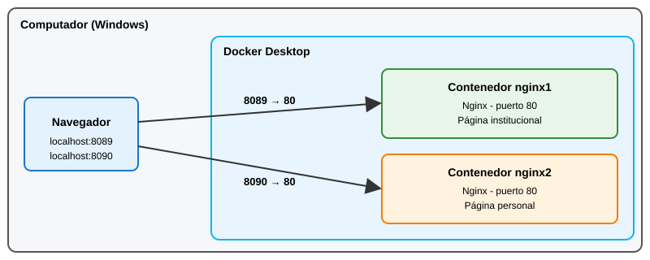

**Figura 3-3.** Esquema básico del funcionamiento de los dos servidores web.

Los archivos HTML permiten definir el contenido de las páginas web. Por ejemplo, con etiquetas como `h1` se coloca un título, con `p` se escriben párrafos y con `title` se establece el título que aparece en la pestaña del navegador. Para esta actividad se modifica el archivo `index.html` de cada servidor: en el primero se coloca información institucional y en el segundo información personal.

Para editar estos archivos se utiliza nano, un editor de texto que funciona directamente en la terminal. Se abre con el comando `nano archivo.html`, se escribe o modifica el contenido y se guarda con `Ctrl + O` (confirmando con `Enter`). Para salir del editor se utiliza `Ctrl + X`. Es una herramienta sencilla y muy usada en entornos Linux porque no requiere interfaz gráfica.

Para terminar, el comando `docker ps` permite revisar los contenedores que están ejecutándose. El comando `docker cp` sirve para copiar archivos entre el computador y un contenedor. Estos comandos fueron importantes para comprobar que los servidores estaban activos y reemplazar las páginas predeterminadas de Nginx por las páginas creadas para la práctica.

## 4. Conocimientos previos

Para realizar esta práctica el estudiante necesita tener claros los siguientes temas:

- Uso básico de la terminal Git Bash.
- Comandos básicos de Linux, como `ls`, `cd` y `pwd`.
- Uso del editor de texto nano en la terminal.
- Estructura básica de un archivo HTML.
- Manejo del navegador web.
- Conceptos básicos de servidores web y puertos.
- Uso inicial de Docker y sus contenedores.

## 5. Objetivos a alcanzar

- Implementar dos contenedores con Nginx utilizando la imagen oficial.
- Configurar puertos diferentes para acceder a cada servidor web.
- Manipular los archivos HTML de los dos contenedores con el editor nano y el comando `docker cp`.
- Publicar una página institucional y otra personal.
- Comprobar desde el navegador que ambos servidores funcionan correctamente.

## 6. Equipo necesario

- Computador con sistema operativo Windows.
- Docker Desktop instalado y en funcionamiento (Docker versión 29.6.1).
- Git Bash para ejecutar los comandos.
- Editor nano (versión 8.7).
- Navegador web para comprobar las páginas.
- Conexión a Internet para descargar la imagen de Nginx, si todavía no se encuentra disponible en el equipo.

## 7. Material de apoyo

- Documentación oficial de Docker: https://docs.docker.com/
- Documentación oficial de Nginx: https://nginx.org/en/docs/
- Imagen oficial de Nginx en Docker Hub: https://hub.docker.com/_/nginx
- Manual del editor nano: https://www.nano-editor.org/docs.php
- Guía de la asignatura.

## 8. Procedimiento

### Paso 1. Verificar Docker y nano

Primero se abrió Docker Desktop y se comprobó que el motor de Docker estuviera activo. Después, desde Git Bash, se ejecutó el comando `docker --version` para confirmar que Docker estaba instalado.

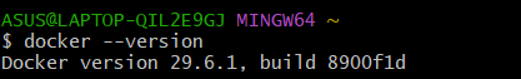

**Figura 8-1.** Verificación de la versión de Docker instalada.

Luego, ubicado en la carpeta de trabajo `informe-nginx`, se verificó que el editor nano estuviera disponible con el comando `nano --version`.

```bash
nano --version
```

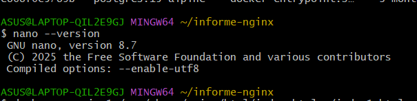

**Figura 8-2.** Verificación de la versión del editor nano.

### Paso 2. Crear el primer servidor web

Se ejecutó el siguiente comando para crear el primer contenedor con Nginx:

```bash
docker run -d --name nginx1 -p 8089:80 nginx
```

Con este comando se creó un contenedor llamado `nginx1`. La opción `-d` permite ejecutarlo en segundo plano y `-p 8089:80` conecta el puerto 8089 del computador con el puerto 80 del contenedor. Como la imagen de Nginx no estaba disponible localmente, Docker la descargó automáticamente.

### Paso 3. Crear el segundo servidor web

Luego se ejecutó el siguiente comando:

```bash
docker run -d --name nginx2 -p 8090:80 nginx
```

Así se creó un segundo contenedor llamado `nginx2`, utilizando el puerto 8090 del computador. Se asignó un puerto diferente para poder acceder a los dos servidores sin que exista un conflicto.

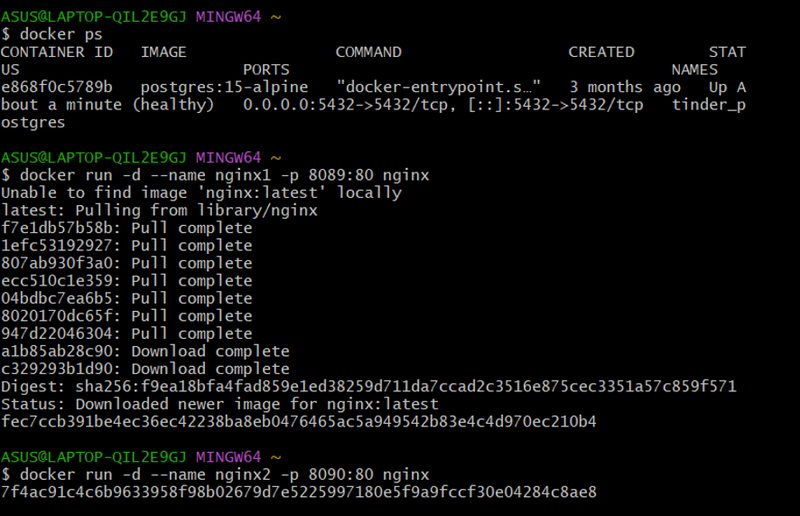

**Figura 8-3.** Revisión de contenedores con `docker ps` y creación de `nginx1` y `nginx2`.

### Paso 4. Comprobar el funcionamiento de los servidores

Se abrió el navegador y se ingresaron las siguientes direcciones:

- Primer servidor: http://localhost:8089
- Segundo servidor: http://localhost:8090

En ambas se mostró la página predeterminada de bienvenida de Nginx, lo que permitió comprobar que los dos contenedores estaban funcionando antes de modificar su contenido.

### Paso 5. Copiar los archivos HTML al computador

Para modificar las páginas, se copiaron los archivos `index.html` originales de los contenedores a la carpeta de trabajo mediante los siguientes comandos:

```bash
docker cp nginx1:/usr/share/nginx/html/index.html ./index1.html
docker cp nginx2:/usr/share/nginx/html/index.html ./index2.html
```

De esta forma se obtuvieron los archivos `index1.html` e `index2.html`, que después se editaron con nano.

### Paso 6. Personalizar la página institucional

Se abrió el archivo `index1.html` con nano:

```bash
nano index1.html
```

Dentro del editor se reemplazó el contenido original por una página con información institucional: un título con el nombre del instituto, la carrera de Desarrollo de Software y una breve explicación de la práctica. Para guardar los cambios se presionó `Ctrl + O` y `Enter`, y para salir `Ctrl + X`.

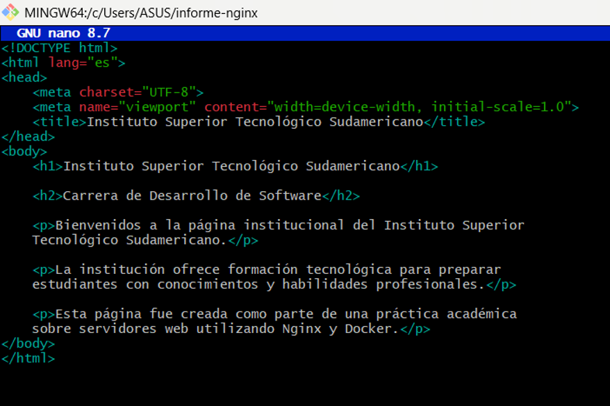

**Figura 8-4.** Código HTML de la página institucional editado en nano.

Después de guardar los cambios, se copió el archivo modificado al primer contenedor:

```bash
docker cp index1.html nginx1:/usr/share/nginx/html/index.html
```

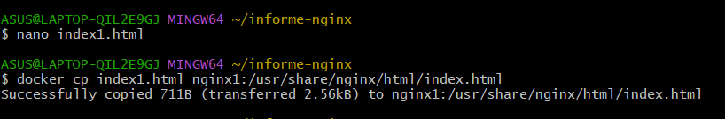

**Figura 8-5.** Edición con nano y copia de `index1.html` al contenedor `nginx1`.

### Paso 7. Personalizar la página personal

A continuación, se abrió `index2.html` con nano y se modificó su contenido para crear una página personal. Se agregaron un título, información del estudiante y un texto relacionado con lo aprendido durante la práctica. Los cambios se guardaron con `Ctrl + O` y `Enter`, y se salió con `Ctrl + X`.

```bash
nano index2.html
```

Después de guardar los cambios, se copió el archivo al segundo contenedor:

```bash
docker cp index2.html nginx2:/usr/share/nginx/html/index.html
```

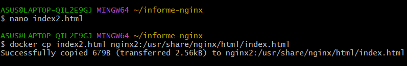

**Figura 8-6.** Edición con nano y copia de `index2.html` al contenedor `nginx2`.

### Paso 8. Verificar las páginas personalizadas

Finalmente, se actualizaron las páginas del navegador para comprobar que los cambios se habían aplicado correctamente. En el puerto 8089 se mostró la página institucional y en el puerto 8090 la página personal. Las capturas de este resultado se presentan en la sección 9.

## 9. Resultados esperados

Al terminar la práctica, se logró crear dos contenedores con Nginx y acceder a cada uno desde el navegador utilizando un puerto diferente. También se modificaron los archivos HTML con el editor nano para mostrar dos páginas con contenidos distintos.

La página del primer servidor presenta información institucional, mientras que la página del segundo servidor contiene información personal del estudiante. Esto permitió entender de forma práctica cómo se pueden ejecutar varios servidores web en Docker y cómo cambiar los archivos que muestran.

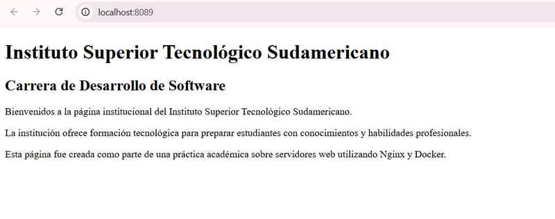

**Figura 9-1.** Resultado final: página institucional en `http://localhost:8089`.

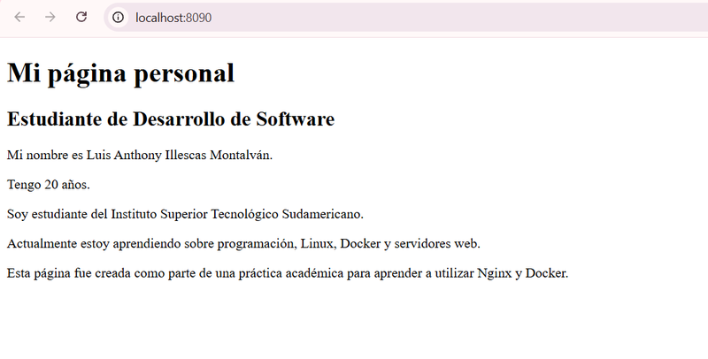

**Figura 9-2.** Resultado final: página personal en `http://localhost:8090`.

## 10. Bibliografía

Docker. (s. f.). *Docker Docs*. https://docs.docker.com/

Docker. (s. f.). *Nginx Official Image*. Docker Hub. https://hub.docker.com/_/nginx

F5, Inc. (s. f.). *NGINX documentation*. https://nginx.org/en/docs/

Free Software Foundation. (s. f.). *GNU nano*. https://www.nano-editor.org/
